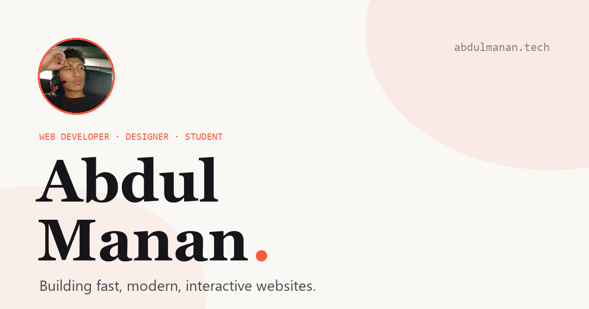

<div align="center">

# Abdul Manan — Portfolio

**Web Developer · Designer · Student**

A fast, interactive, SEO-optimized personal site built from GitHub.
One Python script turns my repos and markdown posts into static pages. No framework, no CMS.

🌐 **[abdulmanan.tech](https://abdulmanan.tech)** &nbsp;·&nbsp; [GitHub](https://github.com/abdulmanan69) · [LinkedIn](https://www.linkedin.com/in/abdulxmanan) · [Instagram](https://www.instagram.com/abdul_x_manan)




</div>

---

## ✨ Features

- **Clean, minimal design** — warm paper palette, one coral accent, serif display type
- **Mouse-interactive** — custom trailing cursor, magnetic buttons, 3D tilt cards, cursor-follow hero blob, scroll reveals, animated counters
- **Dark / light theme** — respects system preference, remembers your choice
- **Loading intro** animation
- **A page per project** — every public repo (minus a denylist) gets a static page with its README, generated at build time
- **Native language chart** + contribution graph, streak and live stat counters
- **GitHub-driven blog** — every post is a markdown file in [`posts/`](posts); push one and it appears, credited to Abdul Manan, with its own SEO metadata
- **SEO-first** — per-page titles/descriptions, `Person` + `BlogPosting` structured data, Open Graph & Twitter cards, `sitemap.xml`, `robots.txt`, canonical URLs
- **Fully responsive** and accessible (reduced-motion aware)

## 🧱 Tech

Plain **HTML + CSS + JavaScript**. No framework, no bundler. A standard-library
Python build ([`tools/build.py`](tools/build.py)) writes the static project and blog pages.

## 📁 Structure

```
portfolio/
├── index.html            # page + SEO meta + structured data
├── style.css             # design system, themes, responsive rules
├── script.js             # interactions + GitHub/blog engine
├── posts/                # ← blog: one .md file per post
│   ├── *.md
│   └── images/           # post cover images
├── projects/             # generated: one page per repo (tools/build.py)
├── blog/                 # generated: one page per post (tools/build.py)
├── tools/                # build.py + repos.py (DENYLIST/FEATURED) + page builders
├── og-image.png          # social share preview
├── favicon.svg  robots.txt  sitemap.xml  site.webmanifest
├── CNAME  .nojekyll       # custom domain + GitHub Pages
└── SAMPLE-POST.md         # template for new posts
```

## ✍️ Writing a blog post

1. Add a `.md` file to [`posts/`](posts) (copy [`SAMPLE-POST.md`](SAMPLE-POST.md)).
2. Fill in the front-matter, then write in markdown:
   ```yaml
   ---
   title: My Post
   date: 2026-07-24
   excerpt: One line for the card and SEO.
   cover: posts/images/my-post.png
   tags: web, design
   ---
   ```
3. Generate the cover and rebuild the crawlable pages:
   ```bash
   python tools/make-cover.py my-post "Short Cover Title" CATEGORY
   python tools/build.py
   ```
4. Commit the generated files along with the post.

## 🔨 Build (projects, blog, sitemap)

GitHub Pages serves plain files, so the build runs on your machine and its output is committed.

```bash
python tools/build.py             # fetch repos from GitHub, rebuild everything
python tools/build.py --offline   # rebuild from the last good GitHub cache
```

It writes one page per public repo at `projects/<slug>/` (README included), the
`projects/` hub, the project cards inside `index.html`, every `blog/<slug>/` page,
`feed.xml` and `sitemap.xml`. Standard library only, no `pip install`.

- **Which repos:** forks, archived repos and anything in `DENYLIST` in
  [`tools/repos.py`](tools/repos.py) are skipped. Sorted by stars, then latest push.
- **Featured:** list repo names in `FEATURED` in the same file to pin them first.
- **Display names / demo links:** `OVERRIDES` in the same file.
- **If GitHub fails** (offline, rate-limited, empty response) the build stops with
  `BUILD FAILED` and writes nothing. Set `GITHUB_TOKEN` to raise the 60 requests/hour
  limit. READMEs are cached in `.cache/` and refetched only when a repo is pushed.

> `tools/make-cover.py` needs three variable fonts in `.fonts/` (Fraunces, Inter,
> JetBrains Mono — links are in the script's docstring). They're gitignored; any
> 1200×675 image works instead.

## 🚀 Deploy

**Netlify** — drag the folder onto [netlify.com/drop](https://app.netlify.com/drop), add the custom domain, done.

**GitHub Pages** — Settings → Pages → deploy from `main` / root. `CNAME` and `.nojekyll` are already included. The contact form needs no server on either host (see below).

**Domain (Cloudflare):** point `A @` to GitHub's IPs (`185.199.108–111.153`) as **DNS-only** during setup, set SSL/TLS to **Full**, then Enforce HTTPS on GitHub.

## 📬 Contact form — how messages actually arrive

No server, no paid plan. The form posts over `fetch`, so the visitor never leaves the page,
and every route below is free with no expiry.

**1. Email — [FormSubmit](https://formsubmit.co) (free, unlimited, no account)**

It has to be activated once, from the live domain:

1. Open <https://abdulmanan.tech/#contact> and send yourself a test message.
2. FormSubmit emails a confirmation link — check the inbox **and the spam folder**.
3. Click it. You also get a random alias like `https://formsubmit.co/ajax/a1b2c3…`.
4. Paste that alias into `CONTACT.endpoint` in [`script.js`](script.js) and into the
   `action` attribute in [`index.html`](index.html), replacing the raw address — the inbox
   then stays out of the page source, away from scrapers.

From then on every submission lands in Gmail as a formatted table.

**2. Instant channels (optional, free forever)**

Fill any of these in `CONTACT` and the button renders itself; leave `""` and it stays hidden.

| Field | Value | What it gives you |
|---|---|---|
| `whatsapp` | digits only, country code first — `"923001234567"` | A tap-to-chat button; the message hits your phone instantly. No API, no limits. |
| `telegram` | username without the `@` | Same idea, via `t.me`. |
| `discord` | a channel webhook URL | Every form submission is also mirrored into a private Discord channel — a push notification the second someone writes, even if email is slow or filtered. |

The Discord webhook URL is visible in the page source (it's a static site — everything is).
Worst case someone posts junk into that one channel; delete the webhook in Discord and
generate a new one.

**3. Fallback that can't fail**

If the endpoint is ever down or blocked, the form hands the message to the visitor's own
mail app, pre-filled. With JavaScript disabled it does a plain form POST and lands on
[`thankyou.html`](thankyou.html). A message never disappears silently.

**Swapping providers:** [Web3Forms](https://web3forms.com) (free, 250/month, instant key, no
activation email) is a drop-in — change `CONTACT.endpoint` to
`https://api.web3forms.com/submit` and add `access_key` to the JSON body in the submit
handler at the bottom of [`script.js`](script.js).

## 🔧 Make it yours

Everything configurable sits at the top of [`script.js`](script.js):

```js
const GH_USER = "abdulmanan69";               // projects + stats
const BLOG = { user, repo, path, branch };    // where posts live
const CONTACT = { email, endpoint, whatsapp, telegram, discord };  // how messages reach me
```

---

<div align="center">
Built &amp; designed by <strong>Abdul Manan</strong> · <a href="https://abdulmanan.tech">abdulmanan.tech</a>
</div>
